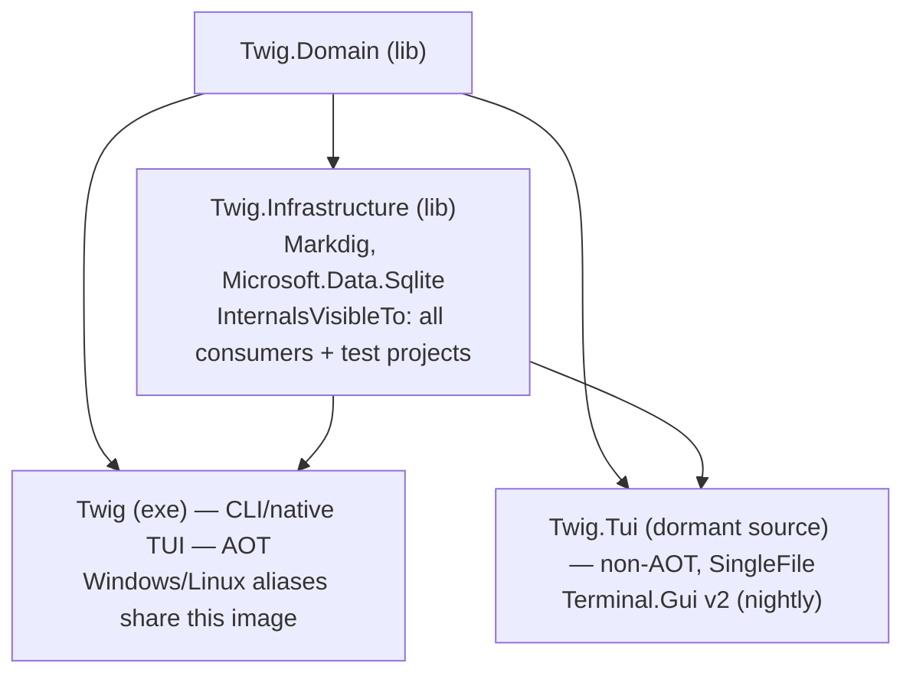

# Build & Release

NativeAOT compilation strategy, versioning, release pipeline, platform-specific
TUI entry points, and local development workflow.

---

## 1. AOT Compilation

### Configuration

The CLI targets `net11.0` (set in `Directory.Build.props`) using the .NET 11 RC3
SDK (`11.0.100-rc.3.26522.148`) pinned in `global.json`. The published
`Twig.Domain`, `Twig.Infrastructure`, and `Twig.RenderTree` libraries multi-target
`net10.0;net11.0` so consumers can continue using .NET 10.
The `twig` CLI is AOT-compiled, with AOT properties set in its `.csproj` file.
MCP is withdrawn from delivery pending redesign; its source is retained only as context.

| Property | Value | Purpose |
|----------|-------|---------|
| `PublishAot` | `true` | Native ahead-of-time compilation |
| `PublishTrimmed` | `true` | IL trimming for size reduction |
| `TrimMode` | `full` | Aggressive — removes all unused code and metadata |
| `StripSymbols` | `true` | PDB symbols excluded from binary |
| `InvariantGlobalization` | `true` | No culture data (~20 MB saving) |
| `JsonSerializerIsReflectionEnabledByDefault` | `false` | Forces source-gen JSON |
| `IsAotCompatible` | `true` | Declares compatibility |

### Constraints & trade-offs

| Constraint | Impact | Resolution |
|------------|--------|------------|
| No reflection | No runtime type inspection | Source-generated JSON (`TwigJsonContext`), explicit service registration |
| No dynamic code gen | IL Emit impossible | ConsoleAppFramework source generators |
| No globalization data | English/UTC only | `InvariantGlobalization=true` |
| Trimming removes unused code | Internal types invisible to tests | `InternalsVisibleTo` attributes on every library |
| No `Assembly.LoadFrom` | No plugin loading | All assemblies statically linked |

### AOT-safe dependency stack

| Package | AOT-safe |
|---------|----------|
| ConsoleAppFramework | ✔ |
| ModelContextProtocol | ✔ |
| Microsoft.Data.Sqlite | ✔ |
| SQLitePCLRaw.bundle_e_sqlite3 | ✔ (native) |
| Spectre.Console | ✔ |
| Markdig | ✔ |
| Terminal.Gui v2 | ✘ (reflection) |

Terminal.Gui's reflection dependency applies only to the dormant legacy
`Twig.Tui` source. macOS support is temporarily suspended. Windows/Linux TUI entry points use the full-trim NativeAOT
`Twig` image and do not publish or launch that companion (see §4).

---

## 2. Versioning

### MinVer

Version numbers are derived from Git tags via **MinVer 7.0.0**.

```xml
<!-- src/Twig/Twig.csproj -->
<MinVerTagPrefix>v</MinVerTagPrefix>
```

| Scenario | Example version |
|----------|-----------------|
| On tag `v1.2.3` | `1.2.3` |
| 4 commits after `v1.2.3` | `1.2.4-alpha.4+{hash}` |
| No tags | `0.0.0-alpha.0+{hash}` |

MinVer injects the version as `AssemblyInformationalVersionAttribute` at
build time. The CLI's `--version` flag, the MCP server info, and install
scripts all read this attribute.

### Design philosophy

- **Tag-driven:** No version files to maintain; `git tag v1.3.0 && git push --tags`
  triggers a release.
- **Semantic versioning:** MAJOR.MINOR.PATCH with pre-release segments.
- **CI integration:** The release workflow reads `GITHUB_REF_NAME` to
  determine the version.

---

## 3. Release Pipeline

### CI workflow (`.github/workflows/ci.yml`)

Runs on pull requests to `main` and pushes to `main`:

```
Restore → Build → Test (ubuntu-latest and windows-latest)
```

Test filter: `Category!=Interactive & Category!=Integration` with a
300-second timeout via `test.runsettings`.

### Release workflow (`.github/workflows/release.yml`)

Triggered by pushing a tag matching `v*`.

#### Build stage — matrix

| Platform | Runner | RID | Archive |
|----------|--------|-----|---------|
| Windows x64 | `windows-latest` | `win-x64` | `.zip` |
| Linux x64 | `ubuntu-latest` | `linux-x64` | `.tar.gz` |

**macOS support is temporarily suspended on both Intel and Apple Silicon.**
CI, release and candidate matrices qualify Windows/Linux only. No new macOS
archives, checksums or companions are published. Installers, runtime entry,
self-upgrade and canvas executable admission refuse macOS explicitly before
network or workspace activity; no Linux fallback is permitted. Existing published
releases are not removed. Restoration requires coordinated runtime, installer,
asset and qualification changes, not merely re-adding a CI runner.

Each platform publishes **Twig** once with
`dotnet publish src/Twig/Twig.csproj -c Release -r {RID} --self-contained true`.

| Platform | Executable layout | Native dependency |
|----------|-------------------|-------------------|
| Windows x64 | `twig.exe`, `twig-tui.exe`, `twig-bench-tui.exe`: identical NativeAOT bytes | `e_sqlite3.dll` |
| Linux x64 | `twig`, `twig-tui`, `twig-bench-tui`: identical NativeAOT bytes | `libe_sqlite3.so` |

Windows/Linux aliases are copied before signing. Windows signing operates on
`twig.exe`, then copies its final signed bytes over both existing aliases before
archiving; timestamps therefore cannot produce different executable hashes. Linux
copies preserve executable mode. Standalone basenames dispatch to the canonical
in-process TUI, with no Go wrapper or legacy companion fallback.

`src/Twig.Tui/Twig.Tui.csproj` and macOS terminal implementation remain dormant
restoration context. Neither is a supported macOS delivery path.

Build steps:

```
Checkout (fetch-depth: 0, filter: tree:0)
  → Setup .NET (SDK pinned in global.json)
  → Restore
  → Build
  → Test
  → Publish Twig once; copy native aliases on Windows/Linux
  → Sign Windows primary; synchronize final signed aliases
  → Archive (zip on Windows, tar.gz on Unix)
  → Upload artifacts
```

#### Release stage

Runs on `ubuntu-latest` after all platform builds succeed:

1. Download all platform archives.
2. Generate changelog from conventional commits between current and
   previous tag. Commit types: `feat`, `fix`, `docs`, `chore`, `refactor`,
   `perf`, `test`, `ci`, `build`, `breaking`.
3. Create GitHub release via `softprops/action-gh-release@v2` with the
   two platform archives, checksums and generated release notes.

#### Native browser responsiveness policy for v0.98.0

**Epic #1165 — Make the native Bench browser consistently responsive**, published
in `PolyphonyRequiem/Twig`, owns the lasting goals, retained evidence and progressive
tightening of native browser responsiveness.

| Validated-ready latency | Lasting goal | Temporary v0.98.0 advisory |
|-------------------------|--------------|---------------------------|
| Cached Bench/item read p95 | ≤750 ms | ≤1000 ms |
| 80-column Table-switch p95 | ≤50 ms | ≤75 ms |

The temporary targets are advisory for this release, not replacement goals or
unconditional publication blockers. Report every miss explicitly and retain all
historical RED observations. Passing a synthetic custom-Bench workload does not
qualify the original default-self workload or production population tails.

Release evidence must show forward progress, including improved observed
80-column Table validated p95, without accepting regression. Use the predeclared
balanced signed-baseline/candidate ABBA full matrices; report p50 and nearest-rank
p95 separately for every operation/width group. An increase beyond
`max(5 ms, 5% of the baseline statistic)` is an unresolved possible-regression flag
that requires investigation. This observational noise margin is not permission to
deliberately slow code or proof of population equivalence. Do not average away a
slow subgroup, widen the plan after seeing results, or claim non-regression from
the earlier noisy sequential runs.

No concession applies to correctness, refusal behavior, identity/source/lease
checks, pending-work conservation, approved signing/trust, exact native alias
identity or all supported-platform full CI gates. The final tag-version payload
must pass its existing offline smoke, Windows signature verification and applicable
native alias checks before irreversible GitHub/NuGet publication; a pretag
candidate is a different build and does not establish the final payload's byte
identity or startup qualification.

---

## 4. Native Entry Points and Dormant Legacy Companion

### Project dependency graph



### twig (CLI)

- Assembly name: `twig`
- Output: `twig.exe` / `twig` (native AOT binary, ~15–20 MB)
- Framework: ConsoleAppFramework (source-gen command routing)
- Rendering: Spectre.Console (rich terminal output)

### Windows/Linux native TUI

`twig tui` calls the existing `BrowserHostCommand` / `BrowserRuntimeFactory`
in-process, with the same options, authority admission and terminal lifecycle as
`twig bench browser`. `twig-tui` and `twig-bench-tui` are copies of this native
image whose basenames select `tui`; they are not companion processes. The stable
Windows/Linux Herdr host ID is `twig-herdr`, with existing action/pane IDs retained
and direct native `twig tui` pane launch.

The source-pinned `tools/tui-candidate.py` delivery tool likewise creates both
Windows/Linux aliases before signing/sealing. Seal and inspect require every alias
to match the primary image byte-for-byte, in addition to the complete strict
inventory and approved Windows publisher/profile/timestamp/source evidence.
Candidate installs and recovery remain private, owner-marked and explicit; the tool
does not install into normal Twig or registered Herdr paths. Candidate CI exercises
`twig tui --help` and both standalone `--help` entry points before and after sealing
on Windows/Linux, then checks normal startup did not change the sealed inventory.
macOS candidate build/install/restore is disabled while support is suspended.

### MCP (withdrawn)

MCP is excluded from supported builds, release archives, local publishing,
installation and automatic companion downloads. Its source remains available
for a separate redesign; current delivery does not expose an MCP server.

### Dormant legacy twig-tui (Terminal UI)

- Assembly name: `twig-tui`
- Output: `twig-tui.exe` / `twig-tui` (self-contained single-file, larger)
- `IsAotCompatible=false` — Terminal.Gui v2 beta relies on reflection
- `PublishSingleFile=true`, `SelfContained=true` — bundles .NET runtime
- Uses Terminal.Gui v2 nightly (`2.0.0-develop.5185`)

`Twig.Tui` source and its Terminal.Gui/runtime dependencies remain for later restoration.
Its macOS entry refuses before SQLite initialization or workspace discovery.
Shared `Twig.Domain`, `Twig.Infrastructure` and other source/dependencies used by
that path are retained; no deletion of shared code follows from retiring the
Windows/Linux legacy executable. Historical research/prototype artifacts also
remain evidence, not alternate supported Windows/Linux UI routes.

### Shared libraries

`Twig.Domain` and `Twig.Infrastructure` are published to nuget.org as
`PolyphonyRequiem.Twig.Domain` and `PolyphonyRequiem.Twig.Infrastructure`.
The packaged versions follow the CLI tag (MinVer derives the version
from the `v*` git tag). The release workflow's `nuget` job runs on every
`v*` tag push, after `verify-ci` succeeds, in parallel with the binary
release job.

External consumers wire everything up via
`TwigServiceRegistration.AddTwigInfrastructure(IServiceCollection,
TwigConfiguration, ...)` — the supported public composition root.

Both projects keep `InternalsVisibleTo` grants for the in-repo CLI / MCP
/ TUI assemblies and the test projects, so the in-repo apps continue to
reach implementation details directly while the published packages
expose only the deliberately-public surface (locked in by
`Microsoft.CodeAnalysis.PublicApiAnalyzers` baselines in
`PublicAPI.Shipped.txt`).

---

## 5. Local Development

### publish-local.ps1

Publishes the Windows native Twig image once and copies its two standalone TUI
entry points into repo-local `.local/bin/` for rapid iteration.

```powershell
./publish-local.ps1          # Build and deploy locally
./publish-local.ps1 -Restore # Remove shims, restore release binary
```

#### What it does

1. Creates `.local/bin/` in the repo root.
2. Recreates generated `.local/bin/`, publishes `twig` once, and copies identical
   bytes to `twig-tui.exe` and `twig-bench-tui.exe`; no `Twig.Tui` build occurs.
   Retires any old repo-local MCP launcher.
3. Installs **shim scripts** in `~/.twig/bin/` that redirect to the local
   build when run from within the repo.
   These developer overrides are not release execution wrappers. Outside the repo,
   TUI overrides invoke `twig-core.exe tui`, since renamed `*-core.exe` filenames
   do not carry the standalone dispatch basename. Restore removes all three
   overrides and restores the installed release executable names.

#### Shim mechanism

The shim (`twig.cmd`) walks up from the current directory to the repo root,
looking for `.local/bin/twig.exe`. If found, it runs the local build. If
not (e.g. running outside the repo), it falls back to the release binary
(`twig-core.exe`):

```batch
:loop
if exist "%dir%\.local\bin\twig.exe" (
    "%dir%\.local\bin\twig.exe" %*
    exit /b %ERRORLEVEL%
)
if exist "%dir%\.git" goto fallback
```

This works from any subdirectory and is compatible with Git worktrees
(each worktree has its own `.local/bin/` but shares `~/.twig/bin/`).

### install.ps1 (Windows)

One-line installer for end users:

```powershell
irm https://raw.githubusercontent.com/PolyphonyRequiem/twig/main/install.ps1 | iex
```

1. Queries GitHub Releases API for the latest release (supports `$env:GITHUB_TOKEN`).
2. Downloads `twig-win-x64.zip` to `$env:TEMP`.
3. Extracts to `~/.twig/bin/` (creates if missing).
4. Adds `~/.twig/bin` to user `PATH` (persistent).
5. Verifies with `twig --version`.

### install.sh (Unix)

```bash
curl -fsSL https://raw.githubusercontent.com/PolyphonyRequiem/twig/main/install.sh | bash
```

Detects OS and architecture (`uname -s`, `uname -m`) to select the correct
RID. Extracts to `~/.twig/bin/`, makes binaries executable, and appends
`PATH` export to the appropriate shell profile (bash, zsh, or fish).

---

## 6. Package Management

### Central package management

`Directory.Packages.props` enables `ManagePackageVersionsCentrally=true`.
All NuGet version pins live in this single file.

### Key dependencies

| Category | Package | Version |
|----------|---------|---------|
| Versioning | MinVer | 7.0.0 |
| CLI framework | ConsoleAppFramework | 5.7.13 |
| MCP protocol | ModelContextProtocol | 1.2.0 |
| Database | Microsoft.Data.Sqlite | 10.0.6 |
| DB native | SQLitePCLRaw.bundle_e_sqlite3 | 2.1.11 |
| Markdown | Markdig | 1.1.2 |
| Console UI | Spectre.Console | 0.54.0 |
| Terminal UI | Terminal.Gui | 2.0.0-develop.5185 |
| DI | Microsoft.Extensions.DependencyInjection | 10.0.6 |
| Hosting | Microsoft.Extensions.Hosting | 10.0.6 |
| Test framework | xunit | 2.9.3 |
| Assertions | Shouldly | 4.3.0 |
| Mocking | NSubstitute | 5.3.0 |

### .NET SDK

`global.json` pins SDK **10.0.104** with `rollForward: latestMinor`.

---

## 7. Testing

### Test projects

| Project | Scope |
|---------|-------|
| `Twig.Cli.Tests` | CLI command integration |
| `Twig.Domain.Tests` | Business logic / domain services |
| `Twig.Infrastructure.Tests` | Data access, ADO client |
| `Twig.Mcp.Tests` | MCP tool contract tests |
| `Twig.Tui.Tests` | TUI interaction tests |
| `Twig.TestKit` | Shared test utilities |

### CI test settings (`test.runsettings`)

```xml
<TestCaseFilter>Category!=Interactive&Category!=Integration</TestCaseFilter>
<TestSessionTimeout>300000</TestSessionTimeout>
```

Interactive and integration tests are excluded in CI. A 5-minute timeout
kills hung tests to prevent pipeline stalls.

### Running locally

```bash
dotnet test                                         # All tests
dotnet test --settings test.runsettings              # CI-safe subset
dotnet test --filter "Category=Integration"          # Integration only
```
