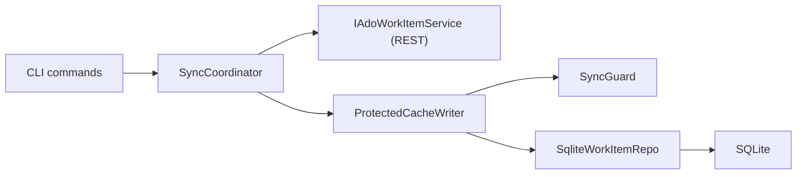

# Data Layer Architecture

This document describes how twig persists, caches, and synchronises work-item data
between the local SQLite store and Azure DevOps.

---

## 1. SQLite Storage

### Database Location

Each workspace stores its cache in a context-scoped SQLite database:

```
.twig/{org}/{project}/twig.db
```

Path construction is handled by `TwigPaths.GetContextDbPath()` in
`src/Twig.Infrastructure/Config/TwigPaths.cs`. The `org` and `project` segments are
sanitised with `TwigPaths.SanitizePathSegment()` to strip filesystem-unsafe characters.
When org/project are not yet configured, a flat fallback (`<twigDir>/twig.db`) is used.

### Connection and WAL Mode

`SqliteCacheStore` (`src/Twig.Infrastructure/Persistence/SqliteCacheStore.cs`) owns the
single `SqliteConnection` for the CLI invocation. On construction it:

1. Opens the connection and enables **WAL journal mode** (`PRAGMA journal_mode=WAL`).
2. Sets a **busy timeout of 5 000 ms** (`PRAGMA busy_timeout=5000`).
3. Calls `EnsureSchema()` to check or rebuild the schema.

WAL mode allows concurrent readers without blocking writes — important when the MCP
server and CLI are running against the same database file.

### Schema Versioning

Twig uses a **drop-and-recreate** strategy instead of incremental migrations. The
compiled-in constant `SqliteCacheStore.SchemaVersion` (currently **9**) is compared
against the value in the `metadata` table. If the version differs or the table is
missing, all tables are dropped and re-created from the DDL string. The
`SchemaWasRebuilt` property signals to callers that a full re-sync is needed.

Before any drop, `GuardMirrorLocalWork` refuses the rebuild when `work_items` holds
local-only work: seed rows (`is_seed = 1`) or dirty rows (`is_dirty = 1`), checked
independently. It throws `mirror-local-work-present` and drops nothing. If the table
is non-empty but lacks either flag column it cannot prove there is no local work, and
the refusal is `mirror-local-work-unverifiable`; an empty table rebuilds. Preserve the
cache files and open them with a compatible Twig version, or export or recover the
work first. The durable `pending.db` is never dropped by a mirror rebuild.

### Provider-Target Bindings in the System Registry

The user-level `system.db` registry is separate from the workspace mirror and
durable work-item store. Its `provider_target_bindings` table gives each immutable
provider target a stable Twig-local binding ID. Identity consists of the provider
kind, canonical resource scope, descriptor kind, and opaque descriptor value,
compared ordinally. Locator and display name are mutable metadata, not identity;
idempotent registration never refreshes them. Updating them requires explicit
identity confirmation and revision compare-and-swap. These bindings contain no
credentials, authentication actors, claims, or approval authority.

A worktree's separate `.twig/provider-target.json` pointer records its binding ID,
live worktree fingerprint, and local revision. Attachment commits or reuses the
system-registry row **before** compare-and-swap replacement of the pointer. If the
pointer write fails, the durable row remains available for an idempotent retry;
the previous pointer is retained. Missing referenced rows, unreadable or invalid
documents, fingerprint mismatches, and stale revisions refuse rather than being
treated as an unattached worktree. Detachment retains a revisioned tombstone.
This foundation does not migrate edited seeds, notes, context, or history and
does not enroll credentials or change existing ADO attachments.

System-registry schema **v9 to v10 is additive and forward-only**, unlike the
disposable mirror's rebuild strategy. Supported v3-v8 registries first follow the
existing additive path to v9, then add the target-binding table at v10. Opening
the registry with the new binary can upgrade it even for an ADO-only operation;
provider-target attachment is not required to trigger the upgrade. Binaries that
only understand v9 then refuse that v10 registry, including otherwise unrelated
ADO operations. Newer, unsupported schema versions likewise fail closed without
rebuilding or downgrading the database. **Restoring the old executable alone is
not a rollback**: rollback requires a compatible database backup as well, and
restoring an older backup would omit later writes. No automatic backup or
downgrade is provided. These are compatibility rules, not a statement that any
installed user's system database has already been upgraded.

### Database Tables

#### Recoverable native drafts (durable storage)

`pending.recoverable_work_item_drafts` lives in the sibling durable `pending.db`,
not the disposable mirror. Durable migration 15 adds this table without replacing
migrations 1-14 or rebuilding existing seed, pending-change, or proposal-journal
records. Durable migrations and the schema-version stamp run transactionally.

`IRecoverableWorkItemDraftStore` owns one draft per canonical native checkout,
connection, binding, and integer work-item identity. Callers obtain that identity
through native admission; constructing a key is not admission. Revision and panel
identity are not key components. The baseline and observed revisions are native
ADO item revisions, distinct from provider-owned opaque revision tokens and the
provider-neutral local-record CAS counter. Field-change and conflict records
retain string-or-null values, including the distinction between null and empty.

The store uses the existing cache operation gate for reads and transactional
generation compare-and-swap for writes. A stale generation refuses without
retrying. Observation/conflict reconciliation may advance draft generation, but
must retain baseline and proposed intent. This is **local metadata CAS**, not a
strict zero-local-write inspection contract. No draft operation flushes unrelated
pending edits or authorizes remote mutation.

The admitted `draft show` envelope independently acquires native observation and
advisory edit capability; a provider reader result alone is not a draft or authority.

#### Exact local draft captures

Durable migration 16 adds nullable `draft_capture_json` to the **existing**
`proposal_journals` table. Generic journals remain unbound; migration and later
capture attempts never backfill them. The internal capture store uses the existing
Domain friend-assembly seam, not a new public DTO or friendship declaration.

Capture owns one non-deferred SQLite transaction (`BEGIN IMMEDIATE`) on the shared
cache connection. It rereads the exact qualified draft, generation, baseline,
conflicts, effects and cached native snapshot, refuses pending edits without
flushing them, and imports the canonical proposal plus immutable capture binding
in that same ambient transaction. Busy/locked errors, stale observations and
pre-commit cancellation refuse without retry or draft mutation. The cache
operation lease alone is not the cross-process writer fence.

The native operation ID hashes a versioned capture identity containing the draft,
generation, native revisions, authority origin and workspace. Thus identical
effects at different generations produce different IDs and ordinary v1 digests,
without changing v1 parsing or canonicalization. The generation binding is the
separate immutable capture fact, **not a new promise about generic v1 digests**.
Exact replay returns the existing row without importing again or refreshing its
preview timestamp; mismatched binding, source, bytes or origin refuses.

Explicit `draft show <id> --document -o json` inspection may acquire metadata and
record genuine native **Served** layout evidence in the existing disposable mirror
`metadata` table. It invalidates only the admitted qualified item's previous receipt
before acquisition; errors or fallback never leave older evidence usable. Explicit
inspection bypasses both document and production-provider session caches for the
requested type, fetching one process identity/roster for its layout and rules.
Ordinary browsing keeps its cached behavior. A served empty form remains empty.
The receipt retains `FormLayout`, actual process rules
(explicit empty differs from unavailable), native origin/storage generation, exact
snapshot identity, and a canonical fingerprint of current local process/schema
inputs. This is **local observed schema identity**, not a server revision, current
remote metadata guarantee, field permission or Apply authority. No schema migration
or generic metadata cache is introduced. It also binds the inspected native Bench
identity and complete stored selector digest. Only an automanaged default self
query retains its existing local canonical normalization account, bound to the
native origin identity; custom or pin-only Benches do not duplicate this account.
Receipt-local Bench JSON stores each selector's discriminator and exact opaque
payload, never its query-only computed accessors. Source-generated wire records
preserve every selector; malformed kinds or payloads refuse rather than disappearing.

`draft capture` requires an explicit Bench, qualified native identity, exact Int64
generation and revision. It does not open a form, refresh metadata, stage pending
work or invoke generic Preview. Under the same `BEGIN IMMEDIATE` as capture, it
rereads the draft, snapshot, receipt, exact saved Bench and fresh process inputs.
Existing native default normalization, local iteration calendar and Bench evaluator
must still include the item; another Bench cannot reuse the inspection even when
both select the item. Each original value
must match the native carried-control inventory exactly, including null versus
empty; native sink capability, known process transitions and retained required-field
gates must accept the effects. Missing/corrupt/changed evidence blocks before any
metadata fetch. Reinspect explicitly to acquire new evidence; capture never retries
or rebases intent.

Capture performs no work-item or work-metadata HTTP and creates no remote mutation
or authorization. Native current-principal admission remains mandatory: a cold
composition may attest its credential through identity-system HTTP before retaining
the local capture. An already-attested composition with unchanged credential material
performs no additional HTTP. Earlier blanket "no HTTP" shorthand does not exempt
cold compositions from principal attestation or permit sharing another runtime's proof.

Capture binding v2 includes the observed evidence fingerprint in native operation
identity, outside ordinary v1 proposal syntax. Existing capture binding v1 still
deserializes and reports missing evidence; it is never backfilled. Generic unbound
proposals keep their existing behavior. Preview and Status inspect retained captures
locally before generic import or process fetch, reporting structured current/stale
issues with no authority. Generic Apply continues to refuse every capture-bound row
before confirmation; native Save consumption remains a separate explicit human
action over the retained digest.

Capture commits with `export-incomplete` recorded in the existing journal error
column before filesystem work. Canonical UTF-8 bytes are written to a unique
temporary file and moved without overwriting the digest-derived export path, then
read back exactly. A different existing file refuses. Failure or cancellation after
commit reports the retained digest and path, not success; `--recover <digest>`
validates the exact retained capture and retries only export without another import,
authorization, preview timestamp refresh or mutation of draft intent.

| Table | Purpose |
|-------|---------|
| `metadata` | Key-value store (schema version, process config data) |
| `work_items` | Cached work items with fields, state, dirty tracking, and `last_synced_at` |
| `pending_changes` | Staged field mutations and notes (auto-increment PK) |
| `process_types` | Process type definitions with states JSON and child-type mappings |
| `context` | Active work item ID and key-value settings |
| `field_definitions` | Custom field metadata (ref name, display name, data type, read-only flag) |
| `work_item_links` | Non-hierarchy link relationships between work items |
| `seed_links` | Links between seed (draft) work items |
| `publish_id_map` | Maps seed IDs to real ADO IDs after publish |
| `navigation_history` | Breadcrumb trail of visited work items |

Key indices cover `parent_id`, `iteration_path`, `assigned_to`, `is_dirty` (partial),
and `is_seed` (partial) on `work_items`, plus `work_item_id` on `pending_changes`.

### Corruption Detection

If the connection fails to open (e.g. corrupt file), `SqliteCacheStore` catches the
`SqliteException` and throws an `InvalidOperationException` advising the user to run
`twig init --force` to rebuild.

---

## 2. Repository Pattern

All persistence contracts live in `src/Twig.Domain/Interfaces/`. Infrastructure
implementations in `src/Twig.Infrastructure/Persistence/` use raw, parameterised SQL
against the `SqliteCacheStore` connection — no ORM.

### Core Interfaces

#### `IWorkItemRepository`

Primary repository for cached work items. Key operations:

- `GetByIdAsync`, `GetByIdsAsync` — single/bulk lookup
- `GetChildrenAsync`, `GetParentChainAsync` — hierarchy traversal
- `GetByIterationAsync`, `GetByIterationAndAssigneeAsync` — sprint queries
- `FindByPatternAsync` — title pattern search (SQL `LIKE`)
- `GetDirtyItemsAsync`, `GetSeedsAsync` — filtered queries
- `SaveAsync`, `SaveBatchAsync` — upsert via `INSERT OR REPLACE`
- `EvictExceptAsync` — cache eviction (keeps only specified IDs)
- `DeleteByIdAsync`, `RemapParentIdAsync` — seed publish support
- `ClearPhantomDirtyFlagsAsync` — cleans `is_dirty` flags with no backing pending changes

**Implementation:** `SqliteWorkItemRepository`. Batch saves wrap all inserts in an
explicit transaction with rollback on failure. Large keep-set evictions (>900 IDs) use a
temp table to avoid the SQLite parameter limit (999).

#### `IContextStore`

Active work-item context and key-value settings. Backed by the `context` table.

- `GetActiveWorkItemIdAsync` / `SetActiveWorkItemIdAsync` — active item cursor
- `GetValueAsync` / `SetValueAsync` — generic key-value pairs

**Implementation:** `SqliteContextStore` — `INSERT OR REPLACE` on every write.

#### `IPendingChangeStore`

Staging area for uncommitted mutations (field edits, notes) before they are flushed to
ADO.

- `AddChangeAsync`, `AddChangesBatchAsync` — enqueue changes (batch is transactional)
- `GetChangesAsync` — ordered retrieval by auto-increment ID
- `ClearChangesAsync`, `ClearChangesByTypeAsync` — per-item or per-type cleanup
- `GetDirtyItemIdsAsync` — distinct IDs with pending changes
- `ClearAllChangesAsync` — bulk clear (preserves seed items)
- `GetChangeSummaryAsync` — note vs. field-edit counts

**Implementation:** `SqlitePendingChangeStore`.

#### `IFieldDefinitionStore`

Custom field metadata synced from ADO.

- `GetByReferenceNameAsync`, `GetAllAsync` — lookup
- `SaveBatchAsync` — batch upsert in a transaction

**Implementation:** `SqliteFieldDefinitionStore`.

#### `IProcessTypeStore`

Process type definitions (states, child types, colours, icons) and the
`ProcessConfigurationData` blob.

- `GetByNameAsync`, `GetAllAsync` — type lookups
- `SaveAsync` — upsert with JSON-serialised state entries
- `SaveProcessConfigurationDataAsync` / `GetProcessConfigurationDataAsync` — stores the
  full configuration blob in the `metadata` table

**Implementation:** `SqliteProcessTypeStore`. State entries and valid child types are
stored as JSON arrays within their respective columns, using source-generated
`TwigJsonContext` serialisers for AOT safety.

#### Other Stores

| Interface | Implementation | Purpose |
|-----------|---------------|---------|
| `IWorkItemLinkRepository` | `SqliteWorkItemLinkRepository` | Non-hierarchy links |
| `ISeedLinkRepository` | `SqliteSeedLinkRepository` | Seed-to-seed links |
| `IPublishIdMapRepository` | `SqlitePublishIdMapRepository` | Seed→real ID mapping |
| `INavigationHistoryStore` | `SqliteNavigationHistoryStore` | Breadcrumb trail |

### Transaction Support

`IUnitOfWork` / `SqliteUnitOfWork` wraps `SqliteTransaction` in an `ITransaction` token.
When a transaction is active, `SqliteCacheStore.ActiveTransaction` is set so that
individual repository commands automatically enrol in the ambient transaction.

---

## 3. Caching Strategy

### Cache-First Reads

All read commands (`status`, `tree`, `show`, `workspace`) read from the local SQLite
cache. Network calls happen only when:

- The cache is empty (first run / after schema rebuild).
- A per-item staleness check determines the item is stale.
- An explicit `twig refresh` is requested.

### Per-Item Staleness

Each `WorkItem` row carries a `last_synced_at` timestamp set at save time. The
`SyncCoordinator` compares `DateTimeOffset.UtcNow - LastSyncedAt` against a configurable
`cacheStaleMinutes` threshold. Items within the threshold return `SyncResult.UpToDate`
without any network call.

### Tiered TTL

`SyncCoordinatorPair` (`src/Twig.Domain/Services/SyncCoordinatorPair.cs`) holds
two `SyncCoordinator` instances with different staleness thresholds:

| Tier | Property | Typical TTL | Used By |
|------|----------|-------------|---------|
| **Read-only** | `SyncCoordinatorPair.ReadOnly` | 30 min | `status`, `tree`, `show` |
| **Read-write** | `SyncCoordinatorPair.ReadWrite` | 5 min | `set`, `link`, `refresh` |

The pair holder enforces `readOnlyStaleMinutes >= readWriteStaleMinutes` so display commands
never refresh more aggressively than mutating ones.

### Protected Cache Writes

`ProtectedCacheWriter` (`src/Twig.Domain/Services/ProtectedCacheWriter.cs`) prevents
remote sync from overwriting items with local pending changes. Before writing, it
queries `SyncGuard.GetProtectedItemIdsAsync()` to build a set of protected IDs (union
of dirty items and items with pending changes), then skips any item in that set.

Batch operations accept pre-computed protected IDs to avoid N+1 queries.

### Admitted Browser Reads

`BrowserOperationModule` owns shared short provider/repository admission, exact
Bench and complete-selector capture, fresh native origin checks and typed failures.
`BrowserReadModule` uses it for complete selected-detail operations shared by the
CLI and native application. `BrowserBenchModule`, `BrowserEditingModule` and
`BrowserReviewModule` reuse the same admission rather than duplicating authority.
Explicit pull uses `ReadOnly.SyncLinksAsync` for the selected root and edge metadata only;
it never flushes pending changes or materializes related targets.

Origin checks include binding/selection revisions, stable principal evidence,
storage generation, and fresh split-configuration observations. Credential
renewal for the same principal is not an actor switch. Failures distinguish
retryable same-origin unavailability from authority invalidation and cancellation;
native registry lock codes remain typed, not interpreted from diagnostic wording.
An admitted context retained on failure is a refusal fence for later actions,
not an authorization or a successful data observation.

Binding resolution discovers the Git anchor through its validated attachment read
and shares that evidence with mirror admission only within the same resolution.
Mirror admission reuses source/root discovery only when their canonical roots match;
different or aliased paths still receive an independent root check. This removes
duplicate Git subprocesses without caching authority across operations. Registry,
marker, endpoint, generation and selection checks remain fresh, as do standalone
storage validation and the browser's final origin/Bench fence.

The provider's live operation lease may also lend its freshly validated origin to
the browser's initial check, but only for the same resolver, canonical workspace,
database, configuration and global-display paths, and matching caller endpoint
and display configuration. It lends the current resolution, not the provider's
startup capture: a same-binding attachment revision invalidates an old browser
capture without preventing a new uncaptured read. Different sources fall back to
independent resolution. Disposed leases and scopes whose owner has ended cannot
lend evidence; later operations and the final origin/Bench fence still resolve
afresh.

The same live origin can lend Git fingerprint evidence to the initial native
repository lease when its canonical root, fingerprint, connection, binding and
generation match that mirror. This skips only duplicate Git discovery: current
marker, unfinished transition, declared endpoint, registry generation and mirror
path checks still run. Standalone repository acquisitions and different origins
continue to discover independently; no startup or returned browser capture can
substitute for the live provider lease at the browser call site.

Returned observations keep private copies of item, related cached facts,
metadata, pending changes and theme. Width reflow uses those retained facts and
the existing native Show renderer without store, provider, shell or network I/O.
Leases are disposed before returning and are never held during terminal idle.
Callers serialize operations on the shared SQLite runtime and reject late
results; these checks do not claim a physically atomic transaction across
registry, configuration files, mirror and durable stores.

Intentional local Bench changes fence the exact expected committed arrangement,
never whichever current Bench is observed later. `BrowserRuntimeFactory` reuses
the CLI's `WorkspaceRegistrationModule` only at startup or explicit reconnect;
old runtime ownership ends before fresh configuration/provider/store composition.
The application serializes native work and owns terminal state on one event loop.
Platform transports and authenticated Herdr topology/control remain adapters.

The shared field document retains server `SystemControls` separately from page
controls, including order, visibility, contribution/read-only flags and resolved
values. The native editor, preserved companion form and external sample consume
those headers without synthesizing a second field list. Sink-declared editability
and captured local baselines govern a durable local batch; rendering/Review never
authorize or apply proposals.

---

## 4. Sync Coordination

### Architecture



### SyncCoordinator

`SyncCoordinator` (`src/Twig.Domain/Services/SyncCoordinator.cs`) is the single-item and
working-set sync engine:

- **`SyncItemAsync(id)`** — checks staleness, fetches from ADO if stale, saves through
  `ProtectedCacheWriter`. Items confirmed deleted in ADO are evicted from the cache.
- **`SyncWorkingSetAsync(workingSet)`** — filters candidate IDs (positive, non-dirty),
  fetches stale items concurrently via `Task.WhenAll`, batch-saves through
  `ProtectedCacheWriter`.
- **`SyncItemSetAsync(ids)`** — like `SyncWorkingSetAsync` but accepts explicit IDs
  without requiring a `WorkingSet`.
- **`SyncChildrenAsync(parentId)`** — unconditional fetch of children (no per-parent
  staleness check).
- **`SyncLinksAsync(itemId)`** — fetches item with non-hierarchy links, persists both.
- **`SyncLinksForSetAsync(itemIds)`** — the plural form. Costs no extra ADO request over a
  plain batch fetch, because the batch URL already carries `$expand=relations`.

🔴 Every path that persists edges writes them **per source id, for every id fetched —
including ids that came back with no edges** (AB#831). Skipping the edgeless ids would
both strand a previously-linked item's stale edges after its last link is removed in ADO,
and leave that id unstamped in `work_item_link_verifications`, where "unstamped" means
"never verified" and is indistinguishable from "no edges".

Partial failures return `SyncResult.PartiallyUpdated` with per-item error details.

### RefreshOrchestrator

`RefreshOrchestrator` (`src/Twig.Domain/Services/RefreshOrchestrator.cs`) coordinates
full workspace refreshes:

1. Executes WIQL to get sprint item IDs.
2. Cleanses phantom dirty flags (`ClearPhantomDirtyFlagsAsync`).
3. Computes protected IDs via `SyncGuard`. There is no bypass — wayfinder 0004 slice 5
   deleted `--force`; overwriting a protected item is a resolution outcome reached through
   the resolver, never a flag that goes around it.
4. Fetches sprint items, active item, and children concurrently. Sprint items and an
   out-of-batch active item are fetched **with relations** (`FetchBatchWithLinksAsync` /
   `FetchWithLinksAsync`) and their edge sets persisted; this costs no extra round trip,
   since the batch URL always expanded relations and the links were simply discarded
   (AB#831). Children come from `FetchChildrenAsync`, which does not return relations, so
   they are deliberately left **unverified** rather than stamped with a claim not earned.
5. Detects revision conflicts (remote revision > local revision on protected items).
6. Saves through `ProtectedCacheWriter` — the only save path.
7. Hydrates ancestor chains iteratively (up to 5 levels), also through `ProtectedCacheWriter`.
   Until 0004 slice 5 this step used an unguarded batch save and clobbered staged edits on
   parent items on the DEFAULT path, with no flag involved.
8. Syncs the working set via `SyncCoordinatorPair.ReadWrite`.

### Push-on-Write: PendingChangeFlusher

`PendingChangeFlusher` (`src/Twig/Commands/PendingChangeFlusher.cs`) pushes staged
changes to ADO:

1. Iterates dirty item IDs.
2. Separates pending changes into **field changes** and **notes**.
3. For field changes: fetches the remote item, runs `ConflictResolutionFlow`, calls
   `ConflictRetryHelper.PatchWithRetryAsync`, then clears the rows it just pushed.
4. For notes: posts comments directly (notes are additive and skip conflict resolution).
5. Post-push resync: re-fetches the item. If anything is still staged that this flush did
   **not** push — a change type the push loop does not recognise, or an edit staged
   concurrently — the resync goes through `ConflictResolutionFlow` and the item keeps its
   pending state. Only when nothing unpushed remains are the rows cleared and the cache
   written. Until 0004 slice 5 this step cleared and overwrote unconditionally, destroying
   such rows silently (the coercion 0003 §4 forbids).
6. Continues past individual failures, collecting them in `FlushResult.Failures`.

### Conflict Resolution

`ConflictRetryHelper` (`src/Twig.Infrastructure/Ado/ConflictRetryHelper.cs`) handles
HTTP 412 (revision mismatch) from the ADO REST API:

1. Attempt 1: `PatchAsync(itemId, changes, expectedRevision)`.
2. On `AdoConflictException`: re-fetch the item for a fresh revision.
3. Attempt 2: `PatchAsync(itemId, changes, freshRevision)`.
4. A second conflict propagates to the caller.

### SyncGuard

`SyncGuard` (`src/Twig.Domain/Services/SyncGuard.cs`) computes protected item IDs by
unioning:
- Items with `is_dirty = 1` from `IWorkItemRepository.GetDirtyItemsAsync()`
- Item IDs with rows in `pending_changes` from `IPendingChangeStore.GetDirtyItemIdsAsync()`

These IDs are excluded from cache overwrites during sync to prevent data loss.

---

## 5. Process-Agnostic Design

Twig never hardcodes process template state names, work item type names, or field
reference names. All process-specific metadata is discovered at runtime.

### IProcessConfigurationProvider

`IProcessConfigurationProvider` (`src/Twig.Domain/Interfaces/IProcessConfigurationProvider.cs`)
returns a `ProcessConfiguration` aggregate built from dynamic data:

```csharp
public interface IProcessConfigurationProvider
{
    ProcessConfiguration GetConfiguration();
}
```

The `ProcessConfiguration` (`src/Twig.Domain/Aggregates/ProcessConfiguration.cs`)
contains per-type `TypeConfig` entries with:
- Ordered state names
- State entries with category metadata
- Allowed child types
- Auto-generated transition rules (Forward/Backward/Cut)

It is built via `ProcessConfiguration.FromRecords(IReadOnlyList<ProcessTypeRecord>)`,
which processes `ProcessTypeRecord` data persisted in `SqliteProcessTypeStore`.

### Dynamic State and Type Discovery

During `twig init`, process type data is synced from ADO via `IAdoWorkItemService` and
stored in the `process_types` table. The `ProcessConfigurationData` blob is also cached
in the `metadata` table. This means:

- State names (e.g. "New", "Active", "Closed") come from ADO, not from code.
- Transition rules are computed from state ordering, not hardcoded per-template.
- Work item types and their child-type relationships are discovered dynamically.

### StateCategoryResolver

`StateCategoryResolver` (`src/Twig.Domain/Services/StateCategoryResolver.cs`) maps a
state name to a `StateCategory` enum (`Proposed`, `InProgress`, `Resolved`,
`Completed`, `Removed`, `Unknown`):

1. **Authoritative path:** searches the `StateEntry` list (from `ProcessTypeRecord`) for
   a case-insensitive name match.
2. **Fallback path:** uses a hardcoded heuristic mapping for common state names across
   ADO process templates (Agile, Scrum, CMMI, Basic).

The `ParseCategory()` method converts ADO category strings (e.g. `"InProgress"`) to the
enum.

---

## 6. Workspace Discovery

### Walk-Up Search

`WorkspaceDiscovery.FindTwigDir()` (`src/Twig.Infrastructure/Config/WorkspaceDiscovery.cs`)
walks up the directory tree from the current working directory (or a supplied start
directory) looking for a `.twig/` subdirectory — analogous to how git locates `.git/`.
Returns `null` if none is found up to the filesystem root.

### WorkspaceGuard

`WorkspaceGuard` (`src/Twig.Mcp/WorkspaceGuard.cs`) validates workspace readiness for
the MCP server:

1. Calls `WorkspaceDiscovery.FindTwigDir(cwd)`.
2. Returns an error if no `.twig/` directory exists.
3. Checks that `.twig/config` is present — if not, advises `twig init`.
4. Returns `(IsValid: true, TwigDir)` on success.

### Path Building

`TwigPaths.BuildPaths(twigDir, config)` selects the layout:
- **Context-scoped** (`.twig/{org}/{project}/twig.db`) when both `Organization` and
  `Project` are configured.
- **Flat** (`.twig/twig.db`) as a fallback for unconfigured workspaces.

A `LegacyDbMigrator` (called from `Program.cs` at startup) handles migration from the
flat layout to the context-scoped layout.

---

## Key Files Reference

| File | Role |
|------|------|
| `src/Twig.Infrastructure/Persistence/SqliteCacheStore.cs` | Connection, WAL, schema management |
| `src/Twig.Infrastructure/Persistence/SqliteWorkItemRepository.cs` | Work item CRUD |
| `src/Twig.Infrastructure/Persistence/SqliteContextStore.cs` | Active context persistence |
| `src/Twig.Infrastructure/Persistence/SqlitePendingChangeStore.cs` | Pending change staging |
| `src/Twig.Infrastructure/Persistence/SqliteProcessTypeStore.cs` | Process type cache |
| `src/Twig.Infrastructure/Persistence/SqliteFieldDefinitionStore.cs` | Field metadata cache |
| `src/Twig.Infrastructure/Persistence/SqliteUnitOfWork.cs` | Transaction support |
| `src/Twig.Domain/Services/SyncCoordinator.cs` | Single-item and working-set sync |
| `src/Twig.Domain/Services/SyncCoordinatorPair.cs` | Tiered TTL coordinator pair |
| `src/Twig.Domain/Services/ProtectedCacheWriter.cs` | Dirty-item-safe cache writes |
| `src/Twig.Domain/Services/SyncGuard.cs` | Protected ID computation |
| `src/Twig.Domain/Services/RefreshOrchestrator.cs` | Full workspace refresh |
| `src/Twig.Domain/Services/StateCategoryResolver.cs` | State→category mapping |
| `src/Twig.Domain/Aggregates/ProcessConfiguration.cs` | Dynamic process config aggregate |
| `src/Twig/Commands/PendingChangeFlusher.cs` | Push pending changes to ADO |
| `src/Twig.Infrastructure/Ado/ConflictRetryHelper.cs` | 412 conflict retry |
| `src/Twig.Infrastructure/Config/WorkspaceDiscovery.cs` | `.twig/` walk-up search |
| `src/Twig.Infrastructure/Config/TwigPaths.cs` | Context-scoped path builder |
| `src/Twig.Mcp/WorkspaceGuard.cs` | MCP workspace validation |
